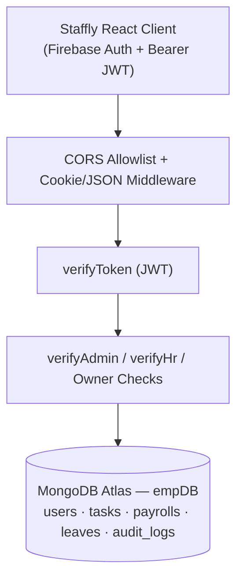

# Staffly — Employee Management & Payroll API Server

> **Role-scoped REST API powering the Staffly Employee Management System.**
> Built with Node.js, Express, MongoDB Atlas, JWT authentication, and Stripe integration—engineered for serverless deployment on Vercel or standalone local execution.

---

## Architecture Overview

The Staffly server acts as the authoritative system of record for users, role permissions, employee work sheets, payroll disbursements, leave requests, and audit governance logs. Authentication combines **Firebase Auth** (identity verification on the client) with **signed HS256 JWTs** verified on protected API routes.



---

## Security & Governance Posture

- **Zero Plaintext Password Persistence:** `POST /users` explicitly strips `password` from incoming payloads before writing to MongoDB, and `GET /users/:email` projects `{ password: 0 }` so credentials are never stored or leaked.
- **Role-Based Access Control (RBAC):**
  - `verifyToken`: Validates `Authorization: Bearer <token>` on all protected routes.
  - `verifyAdmin`: Enforced on destructive and financial administrative routes (`/fire-user/:id`, `/update-role/:id`, `/users/:id/salary`, `/audit-logs`).
  - **Self-Scoped Data Guards:** Employees can only query their own `/tasks/:email` and `/payrolls/:email` records (verified against `req.decoded.email`).
- **Explicit CORS Allowlist:** Configured with `credentials: true` for local development (`http://localhost:5173`) and Firebase Hosting production domains (`staffly-35b73.web.app` / `.firebaseapp.com`).

---

## MongoDB Collections (`empDB`)

| Collection | Purpose |
| :--- | :--- |
| `users` | Staff profiles (`name`, `email`, `photoURL`, `role`, `designation`, `salary`, `bank`, `isVerified`, `workStatus`) |
| `tasks` | Employee daily work-sheet logs (`task`, `hour`, `date`, `user_name`, `user_email`) |
| `payrolls` | Monthly payroll requests & approvals (`month`, `year`, `employee`, `hr_email`, `payment_date`, `payment_status`) |
| `leaves` | Leave / PTO & remote work requests (`employeeName`, `type`, `startDate`, `endDate`, `days`, `reason`, `status`) |
| `audit_logs` | Governance trail (`actor`, `actorRole`, `action`, `target`, `details`, `timestamp`) |

---

## API Endpoint Reference

### Authentication
| Method | Endpoint | Auth | Description |
| :--- | :--- | :--- | :--- |
| `POST` | `/jwt` | Public | Issues a 1-hour signed JWT for an authenticated Firebase email |
| `POST` | `/jwt/logout` | Public | Clears auth cookie state |

### Users & Role Management
| Method | Endpoint | Auth | Description |
| :--- | :--- | :--- | :--- |
| `POST` | `/users` | Public | Registers a new user profile (strips `password`, deduplicates by email) |
| `GET` | `/users/:email` | Public | Returns user profile (excluding password) for status checks |
| `GET` | `/users/role/:email` | `verifyToken` | Returns `{ role: { admin, hr, employee } }` for the signed-in user |
| `GET` | `/all-users` | `verifyToken` | Lists all `employee` and `hr` records for Admin management |
| `GET` | `/employees` | `verifyToken` | Lists all `employee` records for HR verification & payroll |
| `GET` | `/employees/:id` | `verifyToken` | Retrieves a single employee profile by MongoDB ObjectId |
| `PATCH` | `/users/:id` | `verifyToken` | Toggles employee `isVerified` status |
| `PATCH` | `/update-role/:id` | `verifyToken`, `verifyAdmin` | Promotes/demotes a user between `employee` and `hr` |
| `PATCH` | `/users/:id/salary` | `verifyToken`, `verifyAdmin` | Updates an employee's monthly salary |
| `PATCH` | `/fire-user/:id` | `verifyToken`, `verifyAdmin` | Marks an employee's `workStatus` as `"inactive"` |

### Payroll & Disbursements
| Method | Endpoint | Auth | Description |
| :--- | :--- | :--- | :--- |
| `GET` | `/payrolls` | `verifyToken` | Returns all payroll requests across the organization |
| `GET` | `/payrolls/check` | `verifyToken` | Checks whether a payroll request already exists for `(employee_email, month, year)` |
| `POST` | `/payrolls` | `verifyToken` | Creates a new `"pending"` monthly payroll request |
| `PATCH` | `/payrolls/:id` | `verifyToken` | Approves payroll with `payment_date` and `payment_status: "paid"` |
| `GET` | `/payrolls/:email` | `verifyToken` (Owner) | Returns personal payment history (optional `?status=paid` filter) |

### Work Sheets, Leaves & Audit Logs
| Method | Endpoint | Auth | Description |
| :--- | :--- | :--- | :--- |
| `GET` | `/tasks` | `verifyToken` | Lists all employee work-sheet entries for HR/Admin progress views |
| `GET` | `/tasks/:email` | `verifyToken` (Owner) | Lists personal work-sheet entries |
| `POST` | `/tasks` | `verifyToken` | Logs a new task entry |
| `PATCH` | `/tasks/:id` | `verifyToken` | Updates task category, hours, or date |
| `DELETE` | `/tasks/:id` | `verifyToken` | Deletes a task entry |
| `GET` / `POST` / `PATCH` | `/leaves` & `/leaves/:id` | `verifyToken` | Lists, creates, and approves/rejects employee leave requests |
| `GET` / `POST` | `/audit-logs` | `verifyToken` (`verifyAdmin` on GET) | Records and retrieves immutable administrative audit events |

---

## Local Development & Deployment

### 1. Install Dependencies
```bash
npm install
```

### 2. Configure `.env`
Create a `.env` file in the server root (gitignored):

```env
PORT=5000
DB_USER=your_mongodb_atlas_username
DB_PASS=your_mongodb_atlas_password
ACCESS_TOKEN=your_jwt_signing_secret
STRIPE_SECRET_KEY=sk_test_your_stripe_secret_key
```

### 3. Run Locally
```bash
npm start
```

### 4. Deploy to Vercel
Includes [`vercel.json`](vercel.json) configured for `@vercel/node` serverless routing. Push to `main` or run `vercel --prod` with the environment variables above configured in your Vercel project settings.

---

## Related Repository
- **Frontend Client:** [fakhrul62/staffly-full-stack-client](https://github.com/fakhrul62/staffly-full-stack-client)
